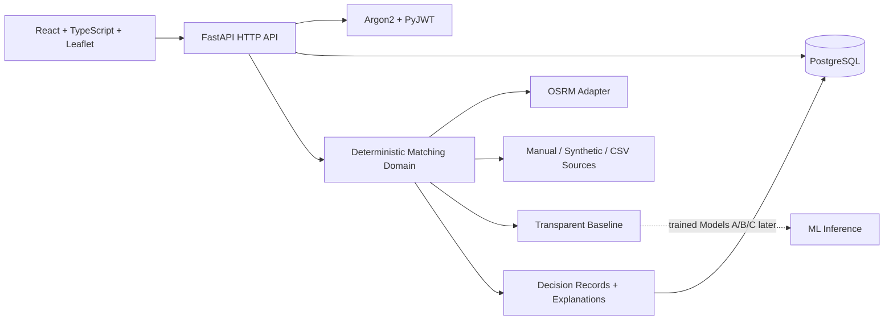
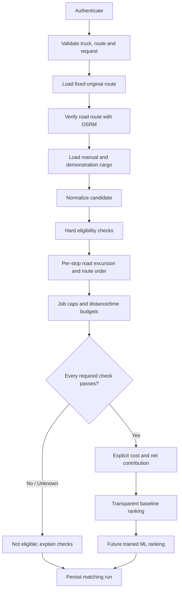

# OptiFreight AI — Architecture

**Architecture:** modular monolith with one React frontend, one FastAPI backend and PostgreSQL persistence. This document describes the intended full architecture and identifies the current implementation boundary; see `IMPLEMENTATION_PROGRESS.md` for verified status.

## Request pipeline

## Separation of concerns

- Domain geometry and deterministic rules are in `backend/app/domain/` and are unit-testable without PostgreSQL.
- HTTP routes are in `backend/app/api/`.
- PostgreSQL models and sessions are in `backend/app/models.py` and `backend/app/db.py`.
- OSRM is behind `backend/app/routing_adapters/client.py`.
- Data sources are isolated in `backend/app/source_adapters/`.
- ML wrappers do not fabricate scores; no model artifact is bundled.
- The frontend keeps the supplied UI and talks to the backend through `frontend/src/api/httpApi.ts`.

## Current implementation boundary

Implemented in code: authentication, manual cargo persistence, route catalogue, OSRM adapter, partial fail-closed matching, explicit active-time/cost inputs, shipments and fleet APIs. Database migration execution, live OSRM calls, complete source ingestion, bundling integration, regulatory checks, ML training and end-to-end browser verification remain pending.

## Invariants

- Original route is immutable during matching.
- Hard filters precede any ranking; unknown never passes.
- Each off-route stop's round-trip road excursion is capped at 40.0 km inclusive.
- No live GPS.
- Net contribution is revenue minus explicit incremental costs.
- Synthetic data and synthetic-trained models are labelled demonstration/research data.
